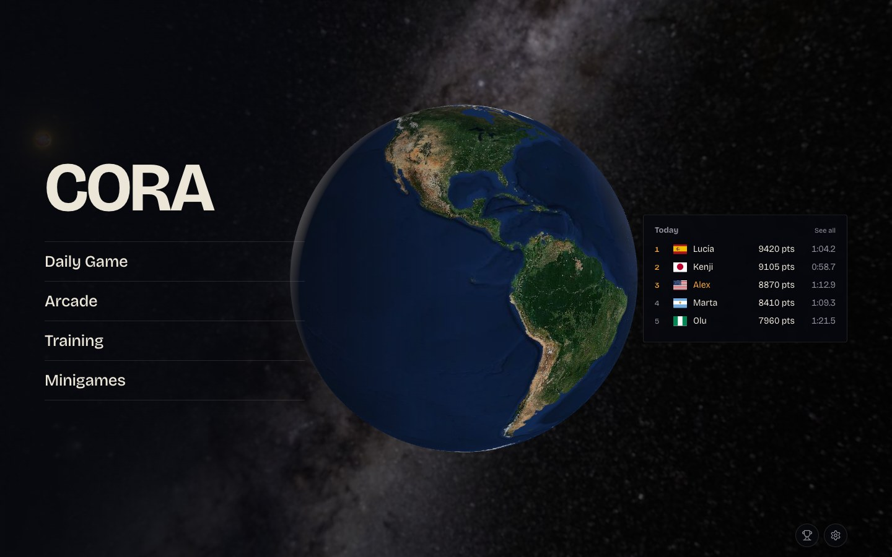
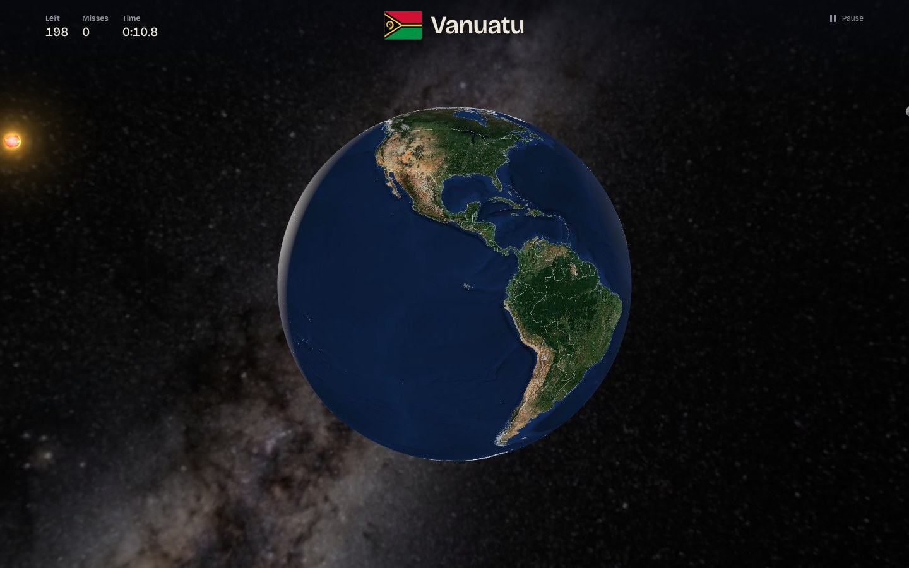
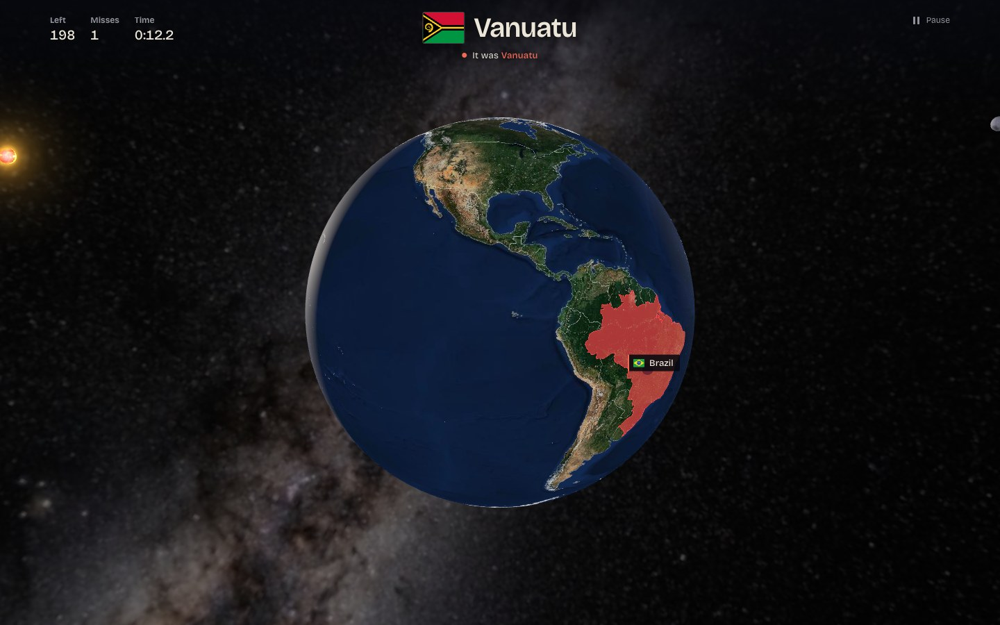
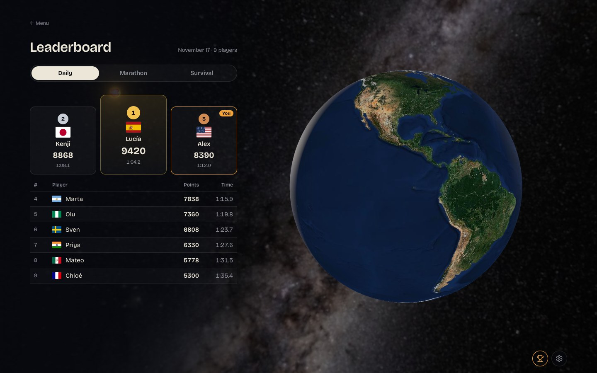
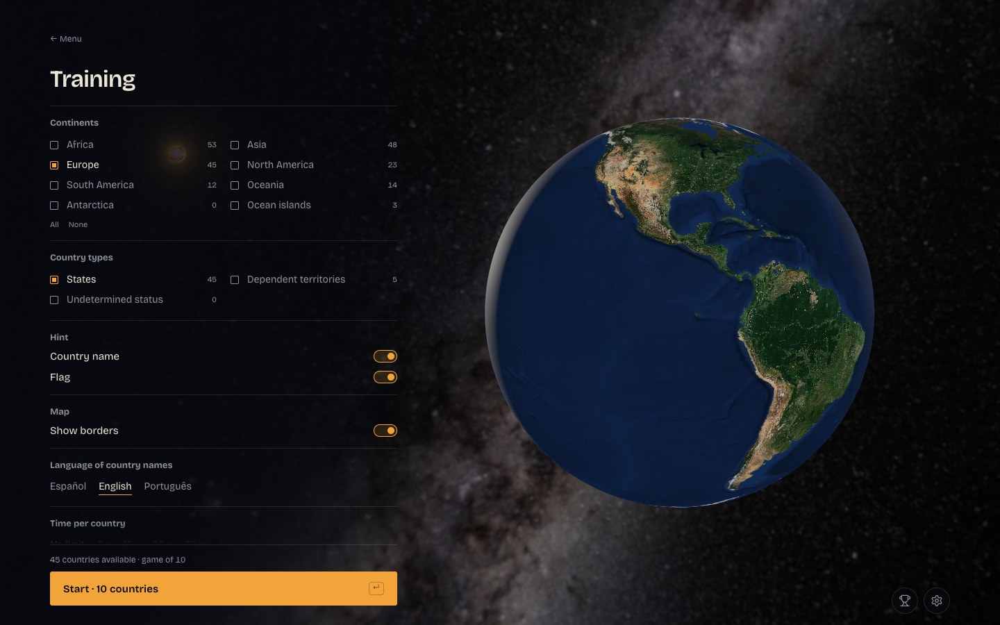
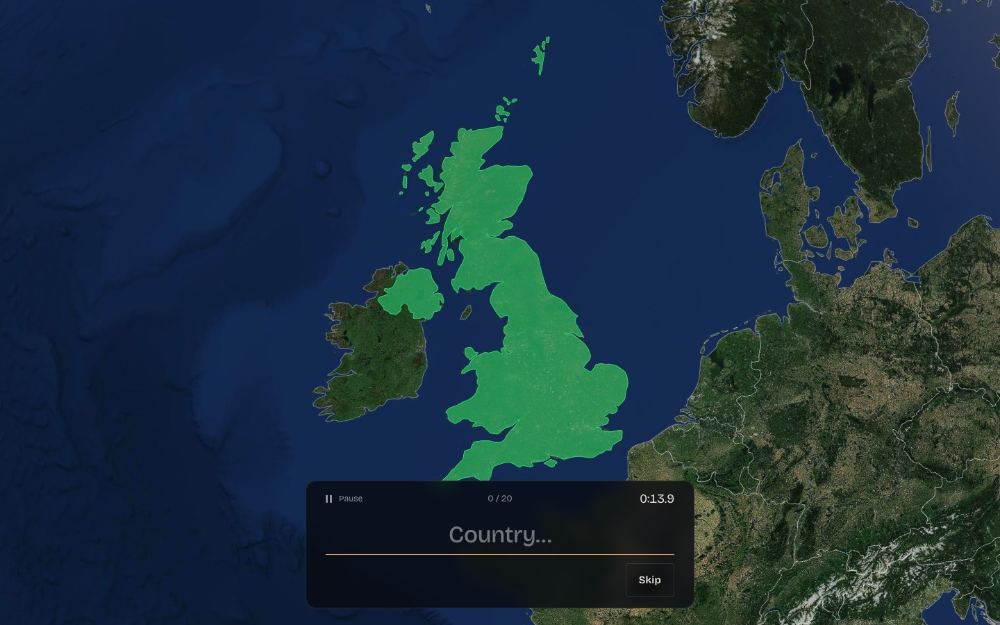
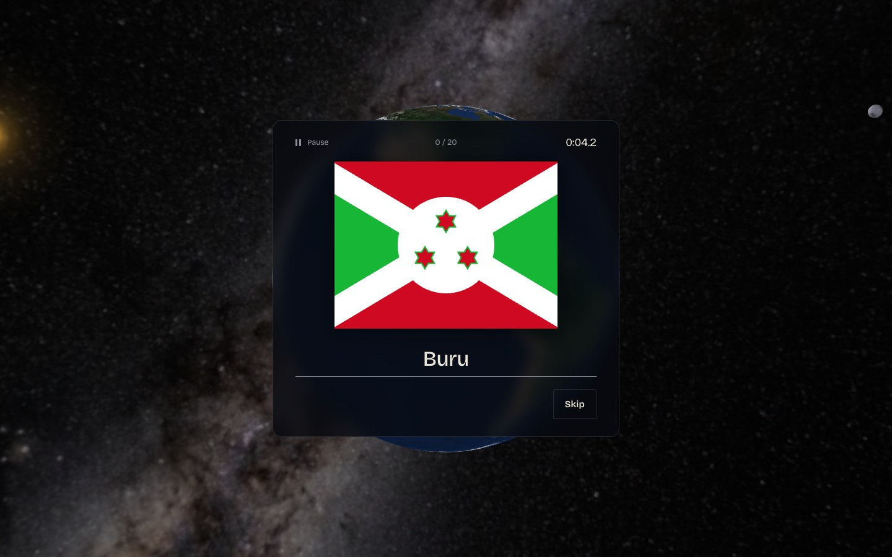

# CORA

**English** · [Español](README.es.md)

CORA is a browser-based geography game played on a photorealistic 3D globe. Find countries from their name or flag, take on a daily challenge shared by every player, climb the global leaderboards, and sharpen your knowledge with flag, map and capital quizzes.



## Overview

The globe is rendered with Three.js and streams Sentinel-2 satellite imagery that gains detail as you zoom in. The Sun, the Moon and a real photograph of the Milky Way sit in the background. Every country and territory is a selectable polygon, and the game identifies the country under the pointer on the client, with no server round-trip.

Online features (daily challenge and leaderboards) run on [Convex](https://convex.dev). The game remains fully playable offline from a backend: if Convex is not configured, the online features are simply hidden.

## Features

- **Daily Game.** Ten sovereign states per day, the same for everyone, chosen by the server. One attempt per player per day. Each country is worth up to 1,000 points: up to 700 for accuracy (based on the distance from the click to the country, scaled by country size) and up to 300 for speed. A live top 5 is shown on the main menu.
- **Arcade.**
  - *Marathon*: find every country in the selection in the shortest possible time. Missed countries come back later in the same run.
  - *Survival*: a 20-second clock that gains 5 seconds with every correct answer.
  - Four difficulty levels (Easy, Normal, Hard, Hardcore), from name and flag with borders to flag only with a per-country time limit. Each difficulty has its own leaderboard.
- **Training.** Build your own session: continents, country types, hint (name, flag or both), borders, language of country names, time per country and number of rounds.
- **Minigames.** Typing quizzes with a timer, a skip queue and a pause menu:
  - *Guess the flag*: a flag is shown, type the country.
  - *Guess the country*: a country lights up on the globe, type its name.
  - *Guess the capital*: a flag and a country are shown, type the capital.

  Answers are tolerant: English, Spanish and Portuguese names are accepted, as are official names and common variants (Eswatini / Swaziland, Czechia / Czech Republic, Côte d'Ivoire / Ivory Coast). Accents, capitalisation and punctuation are ignored, and small typos are forgiven, but the name of a different country is never accepted (Mali is not Malta).
- **Leaderboards.** Daily, Marathon and Survival tables with a podium for the top three, the player's country flag (detected from the request IP on Vercel) and live updates.
- **Languages.** The interface and all country names are available in English (default), Spanish and Portuguese, switchable instantly from Settings.
- **Input.** On desktop, a country is selected by pressing and holding for about one second, so that dragging to rotate the globe never selects by accident. On touch screens a single tap is enough.

## Screenshots

| | |
| --- | --- |
|  |  |
| A round in progress: the hint is shown at the top, the clock runs until the country is selected. | After a wrong answer, the selected country is marked in red and the correct one is revealed. |
|  |  |
| Leaderboards with a podium, country flags and the current player highlighted. | Training: every rule of the session can be customised. |
|  |  |
| Guess the country: the target is highlighted on the globe. | Guess the flag: type the name of the country. |

## Tech stack

| Area | Technology |
| --- | --- |
| Rendering | [Three.js](https://threejs.org) 0.187 (WebGL, custom shaders, CSS2D labels, logarithmic depth buffer) |
| Build | [Vite](https://vite.dev) 8, multi-page (`index.html`, `paises.html`) |
| Backend | [Convex](https://convex.dev) with the [`@convex-dev/aggregate`](https://www.convex.dev/components/aggregate) component for O(log n) rankings |
| Hosting | [Vercel](https://vercel.com) (static site plus one serverless function for country detection) |
| Typography | Bricolage Grotesque via Fontsource |

The client is plain JavaScript (ES modules) with no UI framework.

## Getting started

Requirements: Node.js 20 or later (tested with v24) and npm. An internet connection is needed for the high-resolution satellite tiles.

```bash
npm install
npm run dev        # http://localhost:5173
```

| Script | Description |
| --- | --- |
| `npm run dev` | Development server with hot reload. |
| `npm run build` | Production build into `dist/`. |
| `npm run preview` | Serves `dist/` locally to test the production build. |
| `npm run convex` | Connects to Convex and watches `convex/` for changes. |

### Online features (optional)

```bash
npm run convex     # first run: sign in and create the project; writes .env.local
npm run dev        # in a second terminal
```

`.env.local` stores `CONVEX_DEPLOYMENT` and `VITE_CONVEX_URL` for the development deployment. It is not committed. Restart `npm run dev` after it is created or changed.

## Deployment

The project is designed for Vercel, although any static host works.

1. In the Convex dashboard, open *Settings* and generate a **Production Deploy Key**.
2. In Vercel, add the environment variable `CONVEX_DEPLOY_KEY` with that key (Production only). No other variables are required.
3. Set the build command to:

   ```bash
   npx convex deploy --cmd-url-env-var-name VITE_CONVEX_URL --cmd 'npm run build'
   ```

   This deploys the Convex functions to production and builds the site with `VITE_CONVEX_URL` pointing at the production deployment. The build log prints the backend the site is connected to; make sure it is the production URL. Do not define `VITE_CONVEX_URL` manually in Vercel.

The serverless function in `api/country.js` is deployed automatically. It reads the `x-vercel-ip-country` header and returns the visitor's country code; it does not store IP addresses or call external services.

`CONVEX_DEPLOY_KEY` is a secret and must never be committed.

## Project structure

```
cora/
├── index.html              Game page (all screens and the HUD)
├── paises.html             Reference list of every country and territory
├── api/
│   └── country.js          Vercel function: visitor country from the request
├── convex/                 Backend: schema, scores, daily challenge, rankings
├── public/
│   ├── data/               Country polygons, names, aliases and capitals (generated)
│   ├── flags/              One SVG flag per country (4:3)
│   └── textures/           Earth, Sun, Moon and sky textures
├── scripts/
│   └── prepare-countries.mjs   Builds public/data and public/flags from Natural Earth
├── docs/screenshots/       Images used in this README
└── src/
    ├── main.js             Scene, camera, controls, satellite tiles, selection gestures
    ├── game.js             Game modes, menus, HUD, results and leaderboards
    ├── minigames.js        Typing quizzes and tolerant answer matching
    ├── countries.js        Point-in-country lookup, borders, highlight masks, sizes
    ├── tiles.js            Satellite tile quadtree (level of detail)
    ├── leaderboard.js      Convex client
    ├── i18n.js             English, Spanish and Portuguese strings
    ├── settings.js         Persistent settings (localStorage)
    ├── sound.js            Sound effects (Web Audio)
    └── style.css           Interface styles
```

Detailed technical documentation of every module, the scene layers and the backend is available in Spanish in [README.es.md](README.es.md).

## Data

- 242 countries and territories: 198 sovereign states, 40 dependent territories and 4 with undetermined status.
- Country names in English, Spanish and Portuguese, plus official names and common variants.
- 230 capitals with names in the three languages. Countries with several official capitals accept any of them.

The data files are generated from Natural Earth with:

```bash
node scripts/prepare-countries.mjs ne_50m_admin_0_countries.geojson ne_50m_populated_places.geojson
```

## Credits and licences

| Asset | Source | Licence |
| --- | --- | --- |
| Satellite imagery | [Sentinel-2 cloudless 2024](https://s2maps.eu) by EOX IT Services GmbH (contains modified Copernicus Sentinel data 2024) | CC BY-NC-SA 4.0 |
| Base Earth, Sun and Moon textures | [Solar System Scope](https://www.solarsystemscope.com/textures/) | CC BY 4.0 |
| Sky | [ESO/S. Brunier](https://www.eso.org/public/images/eso0932a/) | CC BY 4.0 |
| Borders, country names and capitals | [Natural Earth](https://www.naturalearthdata.com/) | Public domain |
| Flags | [flag-icons](https://github.com/lipis/flag-icons); Costa Rica state flag from [Wikimedia Commons](https://commons.wikimedia.org/wiki/File:Flag_of_Costa_Rica_(state).svg) | MIT; public domain |
| Icons | [Lucide](https://lucide.dev) | ISC |
| Typeface | [Bricolage Grotesque](https://fonts.google.com/specimen/Bricolage+Grotesque) | OFL 1.1 |

The Sentinel-2 cloudless imagery is licensed for **non-commercial use only**. A commercial deployment of CORA requires a commercial licence from EOX or a different imagery source.
